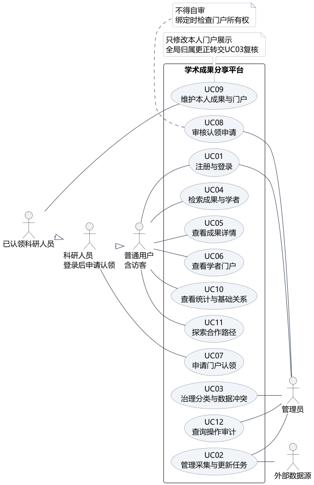
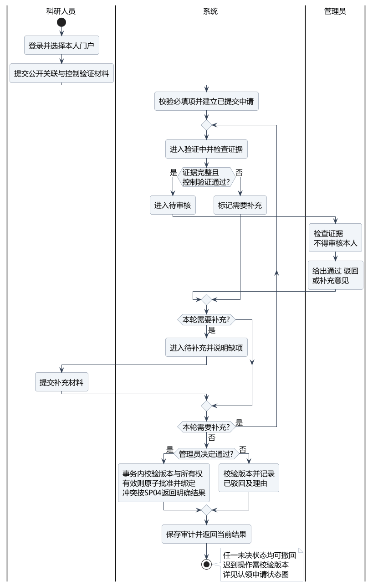
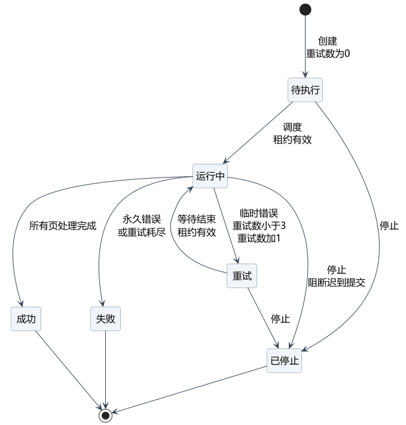
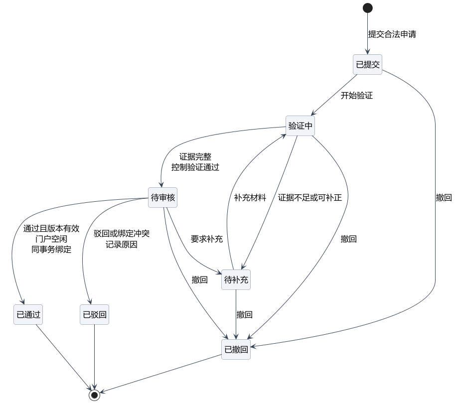

# 学术成果分享平台需求模型与追踪矩阵

本材料把调研结论与SRS连接到参与者、用例、业务流程和状态规则，提供完整的用例说明及需求追踪。图源使用PlantUML，可编辑的puml文件与PNG导出图位于同目录“模型源文件与导出图”；这些文件不标称CodeArts原生工程。

## 1 建模范围与阅读约定

用例图表示参与者的业务目标，活动图表示认领处理流程，状态图分别表示单个采集任务和单个认领申请的生命周期。FR为功能需求，UC为用例，SP为开发规范，AT为验收场景。内部实现动作如清洗和索引不强行建成用户独立用例，其细节在UC02与SPEC中规定。

科研人员继承普通用户的公开查询能力；已认领科研人员进一步拥有本人门户维护权限。外部数据源在系统边界外，是采集用例的支持参与者。登录是各受限用例的前置条件，不表示每次使用都必须重新执行一次登录。

## 2 用户故事与验收

| 故事编号 | 用户故事 | 可检查的完成条件 |
| --- | --- | --- |
| US01 | 作为普通用户，我希望按主题和时间缩小成果范围，以便找到相关结果 | 组合条件只返回交集，排序与生效条件可见 AT06 |
| US02 | 作为普通用户，我希望识别同名学者，以便查看正确门户 | 不同平台学者ID分行，显示署名机构与年份并进入对应门户 AT06 AT08 |
| US03 | 作为科研人员，我希望安全认领本人门户，以便维护成果 | 需要验证与审核，状态和理由可见 AT09 AT10 |
| US04 | 作为已认领者，我希望修正误归属，以便避免错误展示 | 可提交证据；全局变更经复核，原始记录保留 AT11 AT16 |
| US05 | 作为管理员，我希望失败任务可恢复，以便不重复入库 | 重复批次幂等，游标与数据同事务 AT02 AT14 |
| US06 | 作为管理员，我希望审核冲突有明确结果，以便避免双重认领 | 并发批准最多一个成功 AT10 |
| US07 | 作为普通用户，我希望理解统计范围，以便正确解释排名 | 机构全计数与全站去重口径明确 AT12 |
| US08 | 作为普通用户，我希望查看合作路径依据，以便核查关系 | 每条边链接到合著成果，过滤后的无路径有说明 AT13 |

## 3 系统用例图

图中的实线表示参与关系，空心三角表示角色泛化。本图不使用include或extend表达简单的先后顺序。UC09提出的全局数据更正由UC03处理，具体联系通过用例说明与需求追踪表达。

## 4 用例规约

### UC01 注册与登录

参与者：普通用户、科研人员、管理员

前置条件：注册时用户名尚未占用；登录时账号已存在且可用。

基本流程：新用户提交注册信息，系统校验后创建科研人员账号；登录校验通过后建立会话并返回角色；退出使会话失效。

备选与异常：用户名重复不创建账号；凭据无效不建立会话；受限账号不能登录；注册不能自授管理员角色。

后置条件：注册成功产生普通科研人员账号；登录成功建立会话；失败不创建无效账号或会话。

### UC02 管理采集与更新任务

参与者：管理员；外部数据源为支持参与者

前置条件：管理员已登录；来源、许可与适配器已登记。

基本流程：管理员选择来源和范围；系统创建待执行任务；工作进程获取并清洗，执行去重消歧，提交数据与游标；系统发布结果并返回汇总。

备选与异常：超时等临时错误最多重试3次；授权或格式错误失败；疑点记录隔离；停止阻断迟到提交。

后置条件：任务到达成功、失败或已停止，已提交数据和审计可追溯。

### UC03 治理分类与数据冲突

参与者：管理员

前置条件：管理员已登录；存在分类映射或待复核项。

基本流程：管理员查看来源证据；修正分类或选择合并、拆分、独立保留；记录理由；系统保存版本并触发索引统计更新。

备选与异常：证据不足保持待复核；版本陈旧返回冲突；不覆盖原始记录。

后置条件：决定有理由和前后映射，未处理项仍可追踪。

### UC04 检索成果与学者

参与者：普通用户及继承该能力的科研人员

前置条件：有已发布索引；用户无需登录读取公开信息。

基本流程：选择成果或学者模式，输入关键词并过滤；学者按姓名、别名或可靠ORCID检索，同名ID分行，显示署名机构与年份；返回结果、门户入口、命中说明和快照游标。

备选与异常：非法年份返回提示；无结果显示空状态；游标过期要求重新查询。

后置条件：用户获得指定快照中的可读结果。

### UC05 查看成果详情

参与者：普通用户

前置条件：成果ID已提供且记录可公开读取。

基本流程：系统展示四类成果的通用和专属字段、来源与更新时间，并提供关联学者和原始页面入口。

备选与异常：不存在返回404；下架显示受控说明；缺失字段显示未知。

后置条件：不泄露认领证据，用户能核对来源。

### UC06 查看学者门户

参与者：普通用户

前置条件：平台学者ID有效。

基本流程：系统展示姓名、领域、公开机构信息、四类成果与认领状态；用户可按类型和年份查看。

备选与异常：同名分别展示不同ID；未知关联不强行挂入门户；无成果时显示空状态。

后置条件：用户明确当前门户身份与数据范围。

### UC07 申请门户认领

参与者：登录科研人员

前置条件：已登录；选择目标学者门户。

基本流程：提交公开关联及账号控制证据；系统校验后保存申请；申请人查看进度并按需补充。

备选与异常：缺项不能提交；相同幂等请求返回原结果；可在未决状态撤回；已绑定门户不能直接覆盖所有者。

后置条件：申请进入已提交并最终流转至已通过、已驳回或已撤回。

### UC08 审核认领申请

参与者：管理员

前置条件：申请处于待审核；审核人不是申请人。

基本流程：查看验证摘要与材料；给出通过、补充或驳回；通过时系统原子检查状态版本和所有权，保存决定及审计。

备选与异常：门户被他人抢先绑定则驳回并说明；陈旧版本请求不生效；证据不足回待补充。

后置条件：最多产生一个有效所有者绑定，理由可查询。

### UC09 维护本人成果与门户

参与者：已认领科研人员

前置条件：账号拥有目标门户且绑定仍有效。

基本流程：修改简介、展示领域或顺序；带来源补录成果；全局归属纠错提交管理员复核。

备选与异常：越权拒绝；格式不合法提示修正；共同成果原始信息不得被个人直接覆盖。

后置条件：本人展示信息更新或形成待复核更正任务。

### UC10 查看统计与基础关系

参与者：普通用户

前置条件：存在已发布统计快照。

基本流程：选择类型、年份、机构或领域；系统返回数量分布、机构分类排名、关键词趋势或基础合著关系，并注明统计口径。

备选与异常：数据不完整显示覆盖情况；空范围返回零结果但不隐藏口径。

后置条件：结果可按成果ID和快照复核。

### UC11 探索合作路径

参与者：普通用户

前置条件：存在已确认论文作者关系；图规模在边界内。

基本流程：选择学者与过滤条件；系统构建过滤子图，以BFS求最少跳数路径；显示节点和每条边的合著论文证据。

备选与异常：无路径仅对当前范围成立；超过5000节点要求缩小范围；展示截断不得改变计算范围。

后置条件：显示可解释路径或明确无结果原因。

### UC12 查询操作审计

参与者：管理员

前置条件：管理员已登录。

基本流程：按操作人、时间、目标或动作过滤，查看前后版本、原因和关联任务。

备选与异常：普通用户无权限；敏感材料正文不进入日志。

后置条件：审计可追溯并满足最小化展示。

## 5 门户认领审核活动图

泳道区分科研人员、系统、管理员职责。补充材料回到验证，不直接跳过系统验证。图中显示主要补充循环及决定分支；已提交、验证中、待补充、待审核均允许撤回，完整生命周期以状态图和SP04为准。迟到操作校验版本，不能改变已撤回申请。

## 6 数据采集任务状态图

最多进行初次尝试加3次重试。成功表示本次任务所有页已处理完，隔离记录仍单列；已停止不回滚已提交批次。失败或停止后的恢复生成新任务ID，避免修改终态历史。每次提交都应校验任务版本或租约，阻止停止后写入。

## 7 认领申请状态图

已通过、已驳回、已撤回均为本申请终态。批准时同事务绑定所有者，状态和版本守卫适用于每个审核决定；管理员不得自审。被驳回或撤回后再次申请创建新ID；已经通过后的错误绑定通过独立治理与审计纠正。

## 8 需求追踪矩阵

| 需求 | 名称 | 来源 | 用例 | 规范 | 验收 |
| --- | --- | --- | --- | --- | --- |
| FR01 | 账号与权限 | C1 | UC01 | SP04 | AT01 |
| FR02 | 采集任务管理 | C1 | UC02 | SP01 | AT02 |
| FR03 | 数据清洗 | C1 | UC02 | SP01 | AT03 |
| FR04 | 去重与作者消歧 | C1 D7 | UC03 | SP02 | AT04 |
| FR05 | 领域分类 | C1 | UC03 | SP01 | AT05 |
| FR06 | 成果与学者检索 | C1 E2 | UC04 | SP03 | AT06 |
| FR07 | 成果详情 | C1 | UC05 | SP03 | AT07 |
| FR08 | 学者门户 | C1 E1 | UC06 | SP03 | AT08 |
| FR09 | 门户认领申请 | C1 D7 | UC07 | SP04 | AT09 |
| FR10 | 认领审核 | C1 | UC08 | SP04 | AT10 |
| FR11 | 成果维护 | C1 | UC09 | SP04 | AT11 |
| FR12 | 统计与基础关系分析 | C1 | UC10 | SP05 | AT12 |
| FR13 | 合作路径解释 | C1 E3 | UC11 | SP05 | AT13 |
| FR14 | 增量更新 | C1 | UC02 | SP01 | AT14 |
| FR15 | 操作审计 | C1 | UC12 | SP04 | AT15 |
| FR16 | 冲突处理与可追溯更正 | C1 D7 | UC03 | SP02 | AT16 |

非功能追踪：NFR01和NFR07约束SP03与性能一致性验收；NFR02约束数据准备与最终演示；NFR03约束SP04及AT01、AT10、AT11、AT15；NFR04约束SP01、SP04及AT02、AT10、AT14；NFR05约束UC02与数据源故障演示；NFR06约束UC04、UC07；NFR08约束数据源登记与全部导入；NFR09、NFR10约束后续测试、开发证据和部署交付。

## 9 模型自查

六类核心用例均已覆盖：采集UC02、认领UC07、审核UC08、检索UC04、统计UC10、维护UC09。每个功能需求均有用例、规范与验收定位。需要成员重点复核：角色泛化是否符合分工、补充材料是否重新验证、停止后是否阻断迟到写入、并发认领是否最多一个绑定、终态是否误画返回箭头。

图源、导出图和本文插图应一起更新。人工复核人：待填写；日期：待填写；结果及修改项：待填写。
